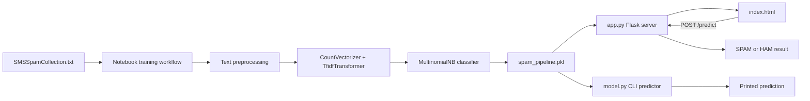

# SMS Spam Detector

A machine learning web application that classifies SMS messages as spam or legitimate using a trained Naive Bayes classifier.

## Overview

This project demonstrates a complete ML pipeline from data analysis to production deployment:
- **Model**: Trained on the UCI SMS Spam Collection dataset (~5,500 messages)
- **Accuracy**: Achieves high precision/recall using TF-IDF vectorization
- **Technology**: Scikit-learn, Flask, Python, NLTK

## Architecture

The project is organized as an offline training workflow and two inference
interfaces that share the same serialized machine learning pipeline.



### Request flow

1. A user enters an SMS message in `app/templates/index.html`.
2. The browser sends the message to the Flask `POST /predict` endpoint in
   `app.py`.
3. The loaded pipeline tokenizes the message, removes punctuation and English
   stopwords, applies TF-IDF features, and predicts `spam` or `ham`.
4. Flask renders the prediction back in the same template.

The command-line path in `model.py` bypasses Flask and sends sample messages
directly to the same persisted pipeline. The pipeline is trained offline in
the notebook and loaded at runtime with Joblib, so prediction does not require
retraining the model.

## Project Structure

```
├── notebooks/
│   ├── SMS Spam Classification.ipynb    # Model training & evaluation
│   ├── SMSSpamCollection.txt             # Training dataset
│   └── test.ipynb
├── model/
│   └── spam_pipeline.pkl                 # Trained ML pipeline (serialized)
├── app/
│   └── templates/
│       └── index.html                    # Web UI
├── app.py                                # Flask web application
├── model.py                              # Standalone prediction script
└── readme.md
```

## Features

- **NLP Pipeline**: Text preprocessing with punctuation removal and stopword filtering
- **ML Model**: Sklearn Pipeline with:
  - `CountVectorizer`: Converts text to token counts
  - `TfidfTransformer`: Applies TF-IDF weighting
  - `MultinomialNB`: Naive Bayes classifier
- **Web Interface**: Simple Flask app with real-time predictions
- **Model Persistence**: Joblib-serialized pipeline for fast inference

## Usage

### Run Web Application
```bash
python app.py
```
Open `http://127.0.0.1:5000` and enter an SMS message to get spam/ham classification.

### Command Line Prediction
```bash
python model.py
```
Classifies hardcoded test messages and prints results.

## Key Implementation Details

- Custom text tokenization function (punctuation removal + NLTK stopwords)
- Trained on imbalanced dataset with 87% ham / 13% spam messages
- Model evaluation with precision/recall/f1-score metrics
- Train/test split (80/20) to prevent overfitting

## Results

The model successfully classifies messages with high accuracy on the test set. Example predictions:
-  "Congratulations! You won a free prize!" → **SPAM**
-  "Hey, are we meeting today?" → **HAM**

## Technologies

- **Python 3.14** | **Scikit-learn** | **Flask** | **NLTK** | **Joblib**

---
*Full ML pipeline implementation with web deployment*
